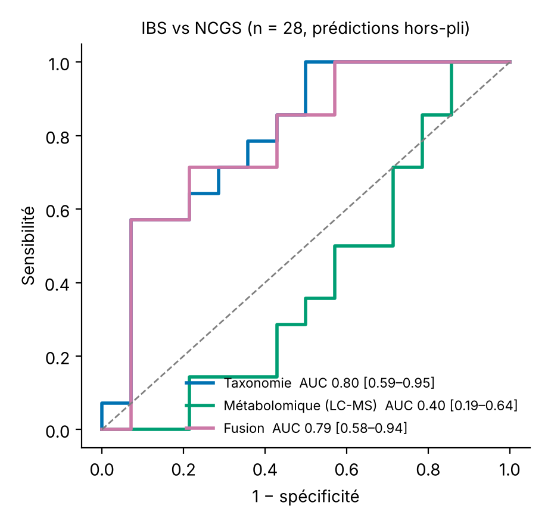
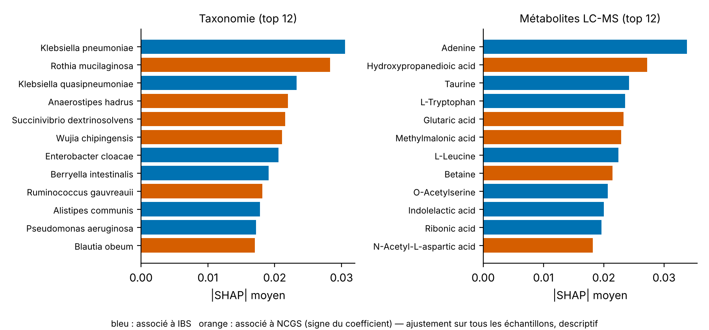

<h1 align="center">🧬 IBS vs NCGS: can gut bacteria tell them apart?</h1>

<p align="center">
A mini research project on public stool metagenomes, rebuilt from the raw reads on free compute.<br>
<a href="https://github.com/fatma2708/ibs-ncgs-microbiome-ml/actions/workflows/ci.yml"></a>


</p>

---

## 💡 The idea in 30 seconds
**IBS** (irritable bowel syndrome) and **NCGS** (non-celiac gluten sensitivity) cause very similar symptoms, and there is no simple test to tell them apart.
I asked whether the bacteria in stool can. I took public data ([PRJNA981497](https://www.ncbi.nlm.nih.gov/bioproject/PRJNA981497), Dixit et al. 2026, *mSphere*), reprocessed it from the raw sequencing reads, and trained a simple model.

> ⚠️ **Honest limits:** 28 people, one cohort, no external validation yet. This is exploratory work, not a diagnostic tool.

## 🔎 What I found
| | Result |
|---|---|
| 🎯 **Can bacteria separate IBS from NCGS?** | A little. **AUC ≈ 0.8** (95% CI 0.64–0.98), 19 of 28 people labelled correctly. Better than chance, not good enough for diagnosis. |
| ✅ **Does my pipeline agree with the original paper?** | Yes. 9 of my top 30 taxa overlap with theirs (about 3 expected by chance). |
| 🦠 **Which bacteria differ?** | **Less *Anaerostipes* in IBS** (q = 0.026 after correction). It makes butyrate, a fuel for the gut lining. |
| 🧪 **Hypothesis to test** | **More *Klebsiella* in IBS** (mostly *K. pneumoniae*, about 9× at genus level, p = 0.013 uncorrected). It is not a general rise in related bacteria. |
| ❌ **What did not work** | Metabolomics alone (AUC 0.40). A *Klebsiella*/*Rothia* ratio looked perfect (0.95), but that was selection bias. Tested properly it falls to 0.64–0.68. |

<p align="center">


</p>

### Why a hypothesis and not a result?
- *Klebsiella* does not survive correction for testing many bacteria at once (q = 0.13).
- Published biology makes it plausible: butyrate-producing bacteria help keep Enterobacteriaceae in check, and some *Klebsiella* make histamine linked to gut pain in IBS mouse models.
- The honest next step is an independent cohort. If it fails there, the hypothesis is wrong.

## 📊 Numbers (n = 28: 14 IBS, 14 NCGS)
| Model | AUC (95% CI) | Permutation p |
|---|---|---|
| Bacteria (logistic regression, CLR) | 0.80 (0.59–0.95) | 0.02 |
| Metabolomics (LC-MS) | 0.40 (0.19–0.64) | 0.60 |
| Both combined (late fusion) | 0.79 (0.58–0.94) | 0.02 |

Robustness: AUC 0.79–0.81 across 4 pre-declared settings. Random forest 0.77. Species diversity alone 0.64. Sequencing depth alone 0.56 (so depth is not driving the result).

## 🛡️ How I checked my own work
- **No data leakage.** Filtering, scaling and tuning all use training folds only (there is a guard test).
- **AUC defined exactly.** 0.79 on average per repeat, 0.81 when predictions are averaged over 20 repeats. I quote it as "≈ 0.8".
- **Confidence interval.** DeLong 0.64–0.98, bootstrap 0.61–0.96. Both slightly understate the true uncertainty.
- **Permutation test is calibrated.** On 40 label-shuffled datasets, p ≤ 0.05 happened in 2.5% of cases and p ≤ 0.10 in 10%. No excess false positives. Details: `results/audit_evaluation.json`.
- **Selection bias caught.** The 0.95 ratio came from picking bacteria on the same samples I scored. See `src/nested_ratio.py`.

## 🗂️ The data, plainly
- BioProject has **42 runs**: 14 IBS, 14 NCGS, and 14 NCGS_PG (the *same* NCGS patients after a gluten-free diet).
- I used **all 14 IBS + all 14 NCGS = 28**. NCGS_PG is excluded so the same patient never appears twice.
- No healthy controls exist in this dataset. Full details: [`DATASET.md`](DATASET.md) and `data/dataset_table.csv`.
- ⚠️ The link between metabolomics and sequencing samples is **inferred** (the authors did not publish a key). It affects only the metabolomics and fusion rows. The bacteria result does not use it.

## 🧭 External validation
I found no independent public IBS vs NCGS cohort with shotgun metagenomes. The model is **frozen** (`models/frozen_model_v1.joblib`) and `src/validate_external.py` is ready, with decision rules written down in advance, for when one exists.
(Running it on the discovery data gives AUC = 1.0. That only proves the code works. It is not a validation.)

## 🚀 Run it
```bash
docker build -f docker/Dockerfile -t ibs-ncgs-ml .
# Data S3: download msphere.00856-25-s0003.xlsx from the paper and put it in data/s3.xlsx
docker run --rm -v $PWD:/app -w /app --entrypoint snakemake ibs-ncgs-ml -c1 --snakefile workflow/Snakefile
# quick test on synthetic data:
docker run --rm --entrypoint bash ibs-ncgs-ml tests/test_pipeline.sh
```
The `bracken_out/*.bracken` profiles come from `processing/` (you must supply the Kraken2 database `k2_standard_08gb_20240605` and GRCh38).

## 🧱 What's inside
| Folder / file | What it does |
|---|---|
| `processing/` | Raw reads → fastp → Bowtie2 (remove human reads) → Kraken2 → Bracken. Resumable, built for Kaggle's 12 h CPU limit (~75 min per sample). |
| `src/run_ml.py` | Models and nested cross-validation. |
| `src/audit_evaluation.py` | Leakage checks, AUC definitions, confidence intervals, permutation calibration. |
| `src/nested_ratio.py` | Honest test of the "pick two bacteria" idea. |
| `src/fdr_differential.py`, `src/klebsiella_followup.py` | Which bacteria differ (corrected for many tests) and the *Klebsiella* follow-up. |
| `src/freeze_model.py`, `src/validate_external.py` | Frozen model and external-validation script. |
| `src/compare_deseq2.py`, `src/compare_models.py`, `src/sensitivity.py`, `src/extra_analyses.py`, `src/make_figures.py` | Comparison with the paper, model baselines, sensitivity checks, learning curve and figures. |
| `workflow/`, `docker/`, `tests/`, `.github/workflows/` | One-command workflow, environments, tests and CI. |

## 🦠 *Klebsiella* follow-up (exploratory, uncorrected p-values)
- The signal comes mostly from ***K. pneumoniae*** (median 0.66% vs 0.04%, p = 0.010). *K. quasipneumoniae* and *K. variicola* lean the same way. *K. oxytoca*, *grimontii* and *michiganensis* do not differ.
- *Escherichia*, *Enterobacter* and *Citrobacter* do not differ, so it is not a general bloom of Enterobacteriaceae.
- A wider group of butyrate producers does not differ (p = 0.21). Only ***Anaerostipes*** stands out.
- *Anaerostipes* and *Klebsiella* are negatively correlated overall (rho = −0.36) but not within each group, so I make no claim of a direct link.

## 📚 Source
Dixit et al. 2026, *Multi-meta-omics reveal distinct microbial genomic profiles and metabolic dysregulation in non-celiac gluten sensitivity*, mSphere. BioProject PRJNA981497.
